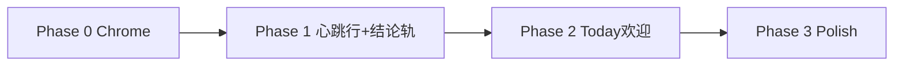

# TUI 布局改造计划（Loop 驱动）

> 版本: v1.2（2026-07-09 review 修复：blocked 不再伪造成 verify FAIL、hydrate 取最新事件、wallClock 去双计、warning/judge stats 映射修正）  
> 状态: Phase 0–2 已落地；Phase 3 polish 可选  
> 关联: [产品设计](design.md) · [today 设计](today.md) · [像素吉祥物](pixel-mascot.md) · [ROADMAP](../ROADMAP.md)

## 1. 背景与目标

Wukong 的产品定位是 **AI Coding Loop 的控制层与验证层**，不是泛聊天 agent。TUI 布局需要同时满足两条线：

1. **交互骨架**参考 Claude Code：上对话、下输入、底部持久 chrome，用户零学习成本迁移。
2. **信息优先级**服从 loop 驱动：界面首要回答「现在在跑什么 loop、卡在哪、能不能合并」，对话区是执行日志，不是唯一信息源。

本计划不重新定义 `/goal` `/loop` `/proof` 的产品语义，只定义 **TUI 如何呈现这些状态**。

### 成功标准

用户在不滚动 transcript 的情况下，能在一眼内看到：

- 当前 goal/loop 目标、迭代进度与停止条件
- 最近 verify / proof 结论（PASS / BLOCKED / pending）
- 今日 focus（若有）
- 模型、cwd、git、context、permission mode

Loop 被 verification gate 挡住时，界面应明确处于 **blocked** 态，并给出 deterministic 的 Next 建议（不调模型）。

---

## 2. Claude Code 布局调研摘要

参考 [TUICommander Claude Code UI Layout](https://tuicommander.com/docs/architecture/agents/claude-code.html)（观测版本 v2.1.81，2026-03-21）及社区 issue 对欢迎屏的描述。

### 2.1 主界面（自下而上）

```text
[agent output / 对话 — 可滚动]

[空行]
✶ Undulating… (timer · token hint)     ← spinner 在输入上方、上分隔线之上
[空行]
──────────────────────────────────────   ← 上分隔线
❯ [用户输入]                             ← 纯 prompt，无边框盒
──────────────────────────────────────   ← 下分隔线
  [status line 1]                        ← 缩进 2 格，0~N 行
  [status line 2]
  [mode line]                            ← 最后一行：⏵⏵ plan / bypass 等
```

要点：

| 元素 | Claude Code |
|------|-------------|
| 输入 | `❯`，无 `╭╮╰╯` 边框 |
| 分隔 | 输入上下各一条 `─`（上分隔线可嵌 label） |
| 状态 | 在输入**下方**，每行缩进 2 格，共 1–3 行 |
| Spinner | 对话底部、上分隔线之上，非独立 pane |
| Context | 嵌在 status line（`Context █░░░ 8%`） |
| Mode | 独立最后一行 |
| **底部 chrome 总高** | **约 5–7 行**（含分隔线） |

### 2.2 欢迎屏

Claude Code 有两种模式（且受项目状态 / 终端焦点影响，社区反馈较多）：

- **Dashboard**：边框、吉祥物、Tips、Recent Activity
- **Compact**：版本 · 模型 · 目录，一行为主

Wukong 对齐策略：**启动用 compact 简报（today）**；loop 运行中不占用大屏欢迎卡。

---

## 3. 设计主张：布局如何服从 loop

这是本计划的核心章节。Loop 驱动不等于「多显示几个字段」，而是把 **loop 状态机**（write → verify → fix → proof，直到 gate 通过）变成界面上可见、可回溯、可行动的仪表。

### 3.1 三层分工（核心原则）

| 层 | 回答的问题 | 载体 | 生命周期 |
|----|-----------|------|----------|
| **历史** | 「第 N 轮为什么被打回？」 | transcript 内 gate 结果消息（✓/✗ + 原因，一轮一条） | 永久，可滚动回溯 |
| **现在** | 「这一秒 loop 在干嘛？」 | **心跳行**：输入上分隔线之上一行 | 随 phase 实时刷新 |
| **结论** | 「现在停下来能不能合并？」 | **footer Loop/Proof 合并轨** | 每次 gate/verify 事件后更新 |

三层各司其职、不互相替代：chrome 只放当前状态和结论，过程细节一律落 transcript。这样 loop 跑 50 轮时 chrome 高度不变，历史照样可查。

### 3.2 垂直空间预算（硬约束）

TUI 最稀缺的资源是垂直行数。**底部 chrome（心跳行到 mode 行）总高 ≤ 7 行**，与 Claude Code 相当：

```text
1  心跳行（active/blocked 时才有）
2  上分隔线
3  ❯ 输入
4  下分隔线
5  Loop/Review 轨（idle 时显示开始 Loop 的引导）
6  Env 轨（model · cwd · git · context）
7  Mode 行（plan/auto/yolo；default 模式可省略）
```

**明确否决五轨堆叠方案**（focus / loop / proof / env / mode 各占一行）：loop 运行时那正是用户最需要看 transcript 日志的时候，chrome 不能反而变高。合并规则：

- **Idle 不常驻 Today 统计**：零值 verify/scan/proof 对新用户没有信息价值；`wukong today` 保留为独立命令。
- **Review 结论优先**：active 时显示 blocking finding 数量；确定性 checks 是 Review 的证据，不再作为三套并列产品轨。

### 3.3 心跳行：loop 的实时仪表

替代现在的泛化 moon spinner（`activityContainer`），格式：

```text
↻ 3/10 · verifying · 42s                          ← loop active
↻ 3/10 · writing · fix auth tests · 12s           ← 迭代中 agent 在写
⛔ gate failed · verify ✗ session.test.ts          ← blocked（warning 色）
↻ 3/10 · retry in 40s (--every 1m)                ← cron 节流等待中
```

设计要点：

1. **位置对齐 Claude Code**：上分隔线之上、transcript 之下，**不是独立带边框 pane**（现 `activity-pane.ts` 的 pane 形态废弃）。
2. **Phase 用 loop 语义**：loop active 时显示 `writing / verifying / judging / proofing`，映射自 goal gate 执行阶段；非 loop 的普通 turn 保留现有 waiting/composing 文案与 moon 动画。用户看到的是「loop 卡在验证」，不是「agent 在 tool call」。
3. **迭代进度显性**：`3/10`（iteration/maxIterations，`GoalSnapshot` 已有字段），让「还剩多少预算」零成本可见。
4. **blocked 不是死状态**：gate 失败瞬间心跳行变 warning 色并给出失败摘要；配合 footer Next 建议，用户可立即行动（steer / `/proof` / `/loop stop`）。

### 3.4 Footer：结论轨

```text
── idle ──────────────────────────────────────────
  Ready · /loop <goal> to start
  [model] │ cwd │ git:(main*) │ ctx 8%

── active ────────────────────────────────────────
  Goal: fix auth tests · until verify-pass · 3/10
  Checks ✓ · Review NEEDS_WORK · 2 blocking
  [model] │ cwd │ git │ ctx 8%
  ⏵ auto mode

── blocked ───────────────────────────────────────
  Goal ● blocked · 5/10 · Next: fix blocking findings
  Checks ✓ · Review NEEDS_WORK · 1 blocking
  [model] │ cwd │ git │ ctx 8%
```

设计要点：

1. **Review 结论是 Wukong 与 Claude Code 最大的差异**：用户应该看到 blocker 和下一步，而不是三套旧命令统计。
2. **Next 建议 deterministic 生成**（规则映射，同 `today` 的 Next 逻辑），不调模型。
3. 现有 goal badge（`[goal ● active · 4m · 7 turns]`）升级为完整 loop 轨；`stopCondition` / `iteration` / `maxIterations` 已在 `GoalSnapshot`（`packages/protocol/src/events.ts`），**无需新增 SDK 管道**。
4. rotating tips 在 active/blocked 模式让位给 loop 轨，idle 恢复。

### 3.5 Gate 结果落 transcript（历史层）

每轮 gate 评估结束，往 transcript 追加一条一等公民消息（复用现有 goal markers / status 消息机制）：

```text
✗ iter 3 gate: verify FAIL — auth/session.test.ts (2 tests) → feedback injected
✓ iter 4 gate: verify PASS · scan clean → goal complete
```

价值：loop 结束后用户可完整回放「每轮为什么没过」；`/export` 也自然带上 loop 审计轨迹。

### 3.6 三种 UI 模式

| 模式 | 触发条件 | 心跳行 | footer 轨 1 | 欢迎区 |
|------|----------|--------|------------|--------|
| **idle** | 无 active goal/loop | 无（普通 turn 沿用 moon spinner） | Today 摘要 | today compact 简报 |
| **active** | goal/loop `active` / `paused` | `↻ iter · phase · 时长` | Goal + Verify/Proof | 收起 |
| **blocked** | goal `blocked` 或 gate 刚失败 | `⛔ gate failed · 原因`（warning） | Goal blocked + Next | 收起 |

模式由 `AppState.goal` + 最近 gate/verify 事件聚合推导，不新增用户配置项（v1）。

---

## 4. 现状与差距

当前 `buildLayout()`（`wukong-tui.ts`）垂直顺序：

```text
transcript → activity → todo → queue → btw → editor(边框盒) → footer
```

| 维度 | 现状 | 目标 |
|------|------|------|
| 输入区 | `>` + `╭╮╰╯` 完整边框盒 | `❯` + 上下 `─` 分隔线，无盒 |
| Spinner | 独立 `activityContainer` + 泛化 moon spinner | 心跳行（loop 语义），非独立 pane |
| Footer | 2 行：mode+model+cwd+git+tips / context | 结论轨（Loop/Proof 或 Today）+ env + mode |
| Goal 状态 | footer 小 badge `[goal ● active · 4m · 7 turns]` | 完整 loop 轨（stop 条件、iter/max） |
| Proof 状态 | 仅在命令输出 / transcript | 常驻 proof 结论 |
| Gate 历史 | goal markers（lifecycle） | 每轮 gate 结果一条消息（含失败原因） |
| 欢迎区 | 始终大边框卡 + MINI_ART | idle：today compact；active：收起 |

已有可复用资产：

- `footer.ts` — goal badge（含 1s 计时器）、git cache、context、mode badges
- `goal-panel.ts` / `goal-markers.ts` — transcript 内 goal 详情与 lifecycle 标记
- `activity-pane.ts` — spinner + tip 逻辑（迁入心跳行后废弃 pane 形态）
- `apps/wukong/src/utils/stats.ts` — `buildTodayBriefing()` + stats 事件读取（today P1 已实现）
- `apps/wukong/src/cli/sub/today.ts` — today CLI/TUI 入口与渲染
- `packages/verification` — verify/proof 结果类型
- `GoalSnapshot`（`packages/protocol`）— `stopCondition` / `iteration` / `maxIterations` 已具备

---

## 5. 组件改造映射

| 文件 / 模块 | 改造内容 | Phase |
|-------------|----------|-------|
| `components/editor/custom-editor.ts` | 去边框盒；prompt `❯`；重定义 `paddingX`（现为边框设计的 4）与 `injectPromptSymbol` 前置假设；bash `! shell mode` 徽标迁至上分隔线内嵌 label；`connectedAbove` 逻辑作废 | 0 |
| `wukong-tui.ts` `buildLayout()` / `mountEditorReplacement()` | 上下分隔线挂载；**决策：审批/问答/selector 等 editor 顶替面板跟随无盒样式还是保留自身边框**（建议保留面板自身边框以示模态） | 0 |
| `components/chrome/footer.ts` | status 行 2 格缩进；mode 独立最后一行；后续加结论轨 | 0–1 |
| `components/chrome/loop-phase.ts` | **新建** 心跳行（iter、loop 语义 phase、stop、耗时、blocked 态） | 1 |
| 新增 `utils/chrome-state.ts` | 聚合 `GoalSnapshot` + 最近 verify/proof/gate → 心跳行与 footer 文案；**IO 策略：进程内缓存 + 事件驱动刷新**（gate/verify/proof 完成事件触发 invalidate，启动读一次 stats/report，禁止每帧读文件） | 1 |
| `wukong-tui.ts` | `updateActivityPane` → `updateLoopPhase`；`uiMode` 推导与切换 | 1 |
| `types.ts` `AppState` | 增加 `lastVerifySummary` / `lastProofSummary`（只读聚合结果） | 1 |
| `controllers/session-event-handler.ts` | gate 结果事件 → transcript 消息 + chrome-state 刷新 | 1 |
| `components/chrome/welcome.ts` | idle：today compact；active：不渲染或一行 | 2 |
| `constant/welcome-art.ts` | MINI_ART 保留；compact 模式单行引用 | 2 |
| `easter-eggs/dance.ts` | 已支持多行 emblem；随 welcome 调整 | 2 |
| `components/panes/activity-pane.ts` | 逻辑迁入 loop-phase 后删除或空壳 | 1 |
| `tui-state.ts` | `uiMode: idle \| active \| blocked`（如不放 AppState） | 1 |

**保留不改（loop 驱动仍需要）：**

- `queue-pane` — steer 排队
- `btw-panel` — 侧问答
- `todo-panel` — agent todo（降级展示，不与 loop stop 混淆）
- transcript 内 `goal-panel` / tool renderers — 详情仍进日志

---

## 6. 欢迎区与吉祥物

### 6.1 策略

| 场景 | 展示 |
|------|------|
| 首次启动 / idle | `today` 简报 compact 块（focus + **今日** stats 摘要）+ 可选 MINI_ART 单行 |
| Dashboard（可选，v2） | 边框卡 + MINI_ART + Tips（对标 Claude dashboard） |
| goal/loop active | **不显示**大欢迎卡，避免占垂直空间 |
| 窄终端（&lt;24 列） | 纯文本 fallback（现有逻辑保留） |

### 6.2 吉祥物来源

- **当前**：`constant/welcome-art.ts` = web `AsciiWukong` `MINI_ART`（6 行）
- **未来可选**：`constant/mascot.ts` 像素帧（见 [pixel-mascot.md](pixel-mascot.md)），按 loop phase 切换 `scan` / `happy` / `staff` 帧

v1 不强制上像素动画；先把布局轨打通。

---

## 7. 分阶段实施

### Phase 0 — 底部 Chrome 对齐 Claude Code

**目标**：输入与状态区结构一致，为 loop 轨腾位置。

| 任务 | 说明 |
|------|------|
| P0-1 | `custom-editor.ts`：移除 `wrapWithSideBorders` 盒渲染；改为 plain `❯` 行 |
| P0-2 | 重定义 `paddingX` / `injectPromptSymbol`（现有 4 列布局为边框设计）；bash `! shell mode` 徽标迁至上分隔线 label |
| P0-3 | editor 上下渲染 `─` 分隔线（上分隔线支持内嵌 label，对齐 Claude Code） |
| P0-4 | `footer.ts`：status 行统一 2 格缩进；mode 独立最后一行 |
| P0-5 | **决策并落实**：`mountEditorReplacement` 的审批/问答/selector 面板样式（建议保留面板自身边框以示模态，验证与无盒 editor 切换的视觉衔接） |
| P0-6 | 视觉回归：plan/bash 高亮、slash hint/autocomplete、审批/问答/session picker、`connectedAbove` 移除后无残留 |

**验收**：手动对比 Claude Code 底部三区（separator / prompt / status）；`typecheck` 通过。

**预估文件**：`custom-editor.ts`、`footer.ts`、`wukong-tui.ts`

---

### Phase 1 — 心跳行 + 结论轨（核心）

**目标**：loop 状态机常驻 chrome，gate 历史落 transcript。

| 任务 | 说明 |
|------|------|
| P1-1 | 新建 `loop-phase.ts` 心跳行：`↻ iter/max · phase · 耗时`；blocked 态 `⛔ + 原因`；cron 节流显示 `retry in Ns` |
| P1-2 | phase 映射：loop active 时 `writing/verifying/judging/proofing`（来自 gate 执行阶段），普通 turn 保留现有文案 |
| P1-3 | 新建 `utils/chrome-state.ts`：聚合 goal + 最近 verify/proof/gate；进程内缓存 + 事件驱动刷新（禁止每帧读 `~/.wukong/stats`） |
| P1-4 | `footer.ts`：结论轨（active：Goal 行 + Verify/Proof 行；idle：Today 摘要行）；tips 在 active 让位 |
| P1-5 | `uiMode` 推导：idle / active / blocked；blocked 时心跳行 + 结论轨 warning 色 + Next 建议（规则映射） |
| P1-6 | gate 结果 transcript 消息：每轮一条 `✓/✗ iter N gate: …`（复用 goal markers / status 通道） |
| P1-7 | `updateActivityPane` → `updateLoopPhase`；`activity-pane.ts` 退役 |

**数据依赖**（M0.5 + today P1 已落地，可开始）：

- `AppState.goal`（`GoalSnapshot` 含 `stopCondition` / `iteration` / `maxIterations`）— 已有
- gate 结果事件（goal gate 完成/打回）— 已有（session 事件）
- `buildTodayBriefing` / focus — `apps/wukong/src/utils/stats.ts` 已有
- 最近 proof/verify — stats 事件（启动读一次 + 事件增量）

**验收**：

- `/goal ... --until verify-pass` 运行时 footer 显示 loop 轨 + stop 条件 + iter/max
- gate 失败进入 blocked：心跳行 warning、footer 显示失败原因 + Next、transcript 落一条 gate 消息
- `/loop` 带 `--every` 时心跳行显示节流等待
- 单元测试：`chrome-state` 聚合与缓存失效；footer 三模式快照（固定宽度截断）；心跳行文案

**预估文件**：新建 2 个，改 `footer.ts`、`wukong-tui.ts`、`types.ts`、`session-event-handler.ts`

---

### Phase 2 — Today 简报替换欢迎卡

**目标**：启动体验对齐「proof 日维度入口」，而非泛 agent 欢迎。

| 任务 | 说明 |
|------|------|
| P2-1 | `welcome.ts` 或新建 `today-panel.ts`：调用 `buildTodayBriefing()`（`apps/wukong/src/utils/stats.ts`）渲染 compact 块 |
| P2-2 | idle 模式：today 块 + 单行 MINI_ART 或省略吉祥物 |
| P2-3 | active/blocked：跳过欢迎渲染（`renderWelcome` 加模式判断） |
| P2-4 | TUI `/today` 与启动简报共用渲染器（现 `cli/sub/today.ts` 的渲染逻辑抽出复用） |

**验收**：`wukong` 启动见 today 简报；`/goal` 启动后欢迎卡消失；focus 变更后 footer Today 摘要同步。

---

### Phase 3 — 模式 polish + 可选 Dashboard

**目标**：体验完整、可配置。

| 任务 | 说明 |
|------|------|
| P3-1 | `config.toml` 或 `tui.json`：`welcomeStyle = auto \| compact \| dashboard` |
| P3-2 | Dashboard 模式：边框 + Tips + 最近 proof（读 stats） |
| P3-3 | 像素吉祥物帧：loop phase 绑定 `mascot.ts` 帧（scan/happy/staff） |
| P3-4 | 窄终端 / 低高度：结论轨降级（只保 Proof 结论与 iter） |

**验收**：配置切换欢迎样式；dashboard 不阻塞 loop active 收起逻辑。

---

## 8. 实施顺序与依赖



| Phase | 前置 | 可并行 |
|-------|------|--------|
| 0 | 无 | 与欢迎区 MINI_ART 已完成改动共存 |
| 1 | M0.5 goal/loop/proof 已落地 ✅ | Phase 0 未完成时结论轨可先占位（`Proof —`） |
| 2 | `wukong today` 已落地 ✅ | 依赖 Phase 1 的 `uiMode` |
| 3 | Phase 2 稳定 | 像素 mascot 可选 |

建议执行顺序：**0 → 1 → 2**；Phase 3 按需。

---

## 9. 测试计划

| 类型 | 范围 |
|------|------|
| 单元 | `chrome-state` 聚合与事件失效；footer 三模式各轨截断；心跳行文案（iter/phase/blocked/节流） |
| 组件 | `WelcomeComponent` idle/active 分支；`FooterComponent` 三模式快照 |
| 手动 | 宽/窄终端；亮/暗主题；`/goal` `/loop` `/proof` 联调；`/dance` 不破坏 emblem；50 轮 loop chrome 高度不变 |
| 回归 | 审批面板、session picker、bash mode（`!` 徽标新位置）、queue steer 布局不破 |

测试条目写入 [verification-cli-test-plan.md](../test/verification-cli-test-plan.md) 新章节「TUI chrome / loop layout」（实施 Phase 1 时同步）。

---

## 10. 风险与「不做」

### 风险

| 风险 | 缓解 |
|------|------|
| 去 editor 边框影响用户「输入区」心智 | 上下分隔线 + `❯` 保持锚点；plan/bash 色高亮分隔线与 prompt |
| editor 去盒牵连 `paddingX` / prompt 注入 / bash 徽标 / 模态面板 | P0 单独 PR；P0-2 / P0-5 显式处理；充分手动回归 |
| footer 变高挤压 transcript | 硬约束 chrome ≤ 7 行；轨合并；tips 让位 |
| proof 数据陈旧或 IO 过重 | 事件驱动刷新 + 进程内缓存；显示 `pending`/时间戳；禁止每帧读文件 |
| loop 语义 phase 与普通 turn 文案混淆 | 仅 goal/loop active 时切 loop 语义；idle turn 保持现状 |

### 明确不做（v1）

- 侧边栏 / 双列 TUI
- footer 五轨堆叠（focus/loop/proof/env/mode 各占一行）
- 用 agent 自评替代 footer 上 deterministic verify/proof 状态
- loop 运行时仍显示 6 行大欢迎卡
- 为布局引入 Web 式 dashboard 路由或新窗口

---

## 11. 开放问题

1. **Prompt 符号**：`❯` 还是保留 `>`？建议 v1 用 `❯` 对齐 Claude Code，bash 仍用 `!`。
2. **心跳行动画**：保留 moon 动画还是 `↻` 静态符号 + 文字刷新？建议 loop active 用 `↻`（语义明确），普通 turn 保留 moon。
3. **Dashboard 默认**：新用户默认 `auto`（有 focus 则 compact）还是始终 compact？建议 **auto**。
4. **hosted 增强**：登录后 footer 是否显示 `wukong.today` 链接？放结论轨右侧，失败静默。

---

## 12. 任务清单入口

执行层勾选见 [TODO.md](../../TODO.md) 章节 **「TUI 布局（Loop 驱动）」**。

文档变更时同步：

- [docs/README.md](../README.md) 设计文档索引
- [design/design.md](design.md) §3 信息架构 TUI 行（实施完成后改「目标」为「已实现」）
