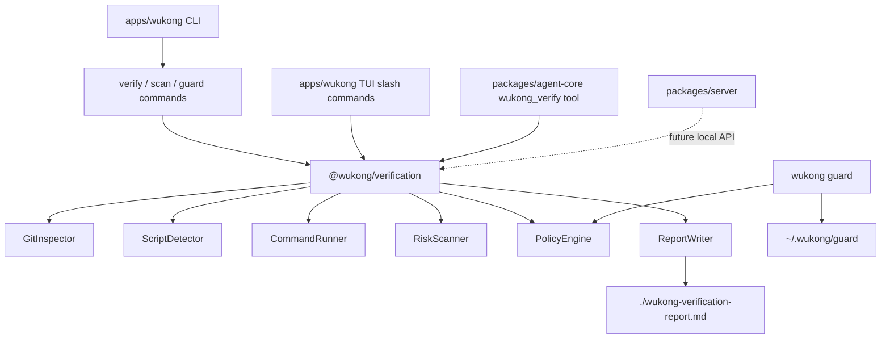

# Wukong CLI 最新技术架构

> 版本: v2.0
> 日期: 2026-07-02
> 适用范围: `wukong_cli` 新 Kimi-code base
> 状态: 当前架构 + P0 本地验证闭环已实现

## 1. 当前事实

`wukong_cli` 当前已经切换到新 Kimi-code base。仓库里真实存在的底座包括：

- `apps/wukong`: top-level CLI、TUI、local server/web UI、ACP entrypoint。
- `packages/node-sdk`: app 和 TUI 访问 agent/runtime 的 SDK facade。
- `packages/agent-core`: agent runtime、tools、skills、permission、config 等核心能力。
- `packages/server`: 本地 REST/WebSocket server。
- `packages/acp-adapter`: Agent Client Protocol server adapter。
- `packages/oauth`: managed Wukong OAuth/provider 支持。
- `packages/migration-legacy`: legacy 数据迁移。

当前 top-level CLI 已有：

```text
wukong
wukong -p
wukong provider
wukong acp
wukong server
wukong web
wukong login
wukong doctor
wukong export
wukong vis
wukong migrate
wukong upgrade
```

商业化重构已经补齐的 P0 本地闭环是：

```text
wukong verify
wukong scan
wukong guard
/verify
/scan
/guard
/report
wukong_verify
```

## 2. 架构原则

1. **验证核心独立成包**
   `verify`、`scan`、agent tool、未来 CI/server 都复用同一个 `@wukong/verification`。

2. **CLI 只做输入输出编排**
   `apps/wukong/src/cli/sub/*` 只解析参数、调用核心包、格式化输出和设置 exit code。
   `apps/wukong/src/tui/commands/verification.ts` 和 `packages/agent-core/src/tools/builtin/verification/wukong-verify.ts` 也复用同一核心包。

3. **确定性验证先于 AI review**
   P0 `verify` 默认不调用模型，必须离线可用。AI 深度 review 放到 P1。

4. **guard 是 best-effort 防护**
   P0 guard 是交互式 shell 风险确认层，不宣传不可绕过。更强隔离以后再接 sandbox/tool-policy。

5. **不复活旧 `packages/cli` / `packages/mcp-server`**
   legacy 文档和旧 MCP server 架构不再作为实现依据。

## 3. 目标模块图



## 4. `@wukong/verification` 包

新增包：

```text
packages/verification/
  package.json
  tsconfig.json
  tsdown.config.ts
  src/
    index.ts
    types.ts
    git.ts
    scripts.ts
    runner.ts
    risks.ts
    policy.ts
    report.ts
    verify.ts
    scan.ts
    guard.ts
  test/
    verify.test.ts
    scan.test.ts
    policy.test.ts
```

职责：

- 检测 git 状态和 diff。
- 自动识别 Node 项目的 `lint`、`typecheck`、`test`、可选 `build`。
- 执行显式或自动选择的命令。
- 扫描 diff 和文件名风险。
- 生成 Markdown report 和 JSON result。
- 提供 guard command risk classifier。

不负责：

- Commander 参数解析。
- TUI 交互。
- 云端上传。
- 计费。
- 完整 sandbox。

## 5. CLI 命令层

新增文件：

```text
apps/wukong/src/cli/sub/verify.ts
apps/wukong/src/cli/sub/scan.ts
apps/wukong/src/cli/sub/guard.ts
```

并在 `apps/wukong/src/cli/commands.ts` 注册：

```ts
registerVerifyCommand(program);
registerScanCommand(program);
registerGuardCommand(program);
```

### `wukong verify`

契约：

```bash
wukong verify
wukong verify --build
wukong verify --command "pnpm test"
wukong verify --report ./reports/evidence.md
wukong verify --timeout 180
wukong verify --json
wukong verify --no-report
```

退出码：

| 情况 | exit code |
|---|---:|
| 命令通过且没有 high risk | 0 |
| 命令通过但有 low/medium risk | 0 |
| 命令失败或有 high risk | 1 |
| 参数/环境错误 | 2 |

### `wukong scan`

契约：

```bash
wukong scan
wukong scan --diff
wukong scan --secrets
wukong scan --json
wukong scan --report ./reports/risk.md
```

`scan` 不运行项目命令，只做只读风险扫描。

### `wukong guard`

契约：

```bash
wukong guard --status
wukong guard --stats
wukong guard --enable
wukong guard --disable
wukong guard -- rm -rf ./tmp
```

P0 行为：

- `--status`: 显示 guard 是否启用。
- `--stats`: 显示本地 guard event 统计。
- `--enable`: 写入本地配置，P0 不自动改用户 shell profile。
- `--disable`: 关闭本地配置。
- `-- <command>`: 对命令做风险分类，高风险默认返回非零并提示用户。

## 6. 数据与文件

P0 本地文件：

```text
./wukong-verification-report.md
~/.wukong/guard/config.json
~/.wukong/guard/events.jsonl
```

上传/同步不是 P0 的必需能力。未来如果接云端，默认只上传 metadata 和 redacted report。

## 7. 风险规则

### Diff 风险

| 规则 | 等级 |
|---|---|
| `TODO/FIXME/placeholder/not implemented/coming soon` | high |
| `mock/fake/dummy/hardcoded/sample data` | high |
| `describe.only/it.only/test.only` | medium |
| `describe.skip/it.skip/test.skip` | medium |
| `console.log/debugger` | medium |
| `.env/secret/credential/private-key` 文件变化 | high |
| 源码变更但无测试变更 | medium |
| 未发现验证命令 | high |

### Command 风险

| 命令 | 条件 | 等级 |
|---|---|---|
| `rm` | 包含 `-r` 或 `-f` | high |
| `git` | `reset --hard` | high |
| `git` | `clean -f/-df/-xdf` | high |
| `curl/wget` | pipe 到 shell 或上传数据 | high |
| `bash/sh/zsh` | 参数中包含 `curl` 或 `wget` | high |

## 8. 自动化测试

最低测试层级：

1. `packages/verification/test/*`: core unit tests。
2. `apps/wukong/test/cli/verification-commands.test.ts`: CLI command registration / smoke tests。
3. `apps/wukong/test/tui/commands/verification.test.ts`: TUI verification slash command handlers。
4. `packages/agent-core/test/tools/wukong-verify.test.ts`: agent tool execution and structured summary。
5. `pnpm --filter @wukong/verification test`。
6. `pnpm --filter @wukong/wukong run typecheck`。
7. `pnpm --filter @wukong/agent-core run typecheck`。
8. `pnpm -C apps/wukong run dev:cli-only -- verify --no-report`。
9. `pnpm -C apps/wukong run dev:cli-only -- scan --json`。
10. `pnpm -C apps/wukong run dev:cli-only -- guard --status`。

## 9. 后续扩展

P1:

- report history。
- `review --deep`。

P2:

- team rules。
- audit log。
- hosted reports。
- sandbox runner。
