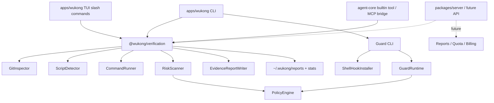
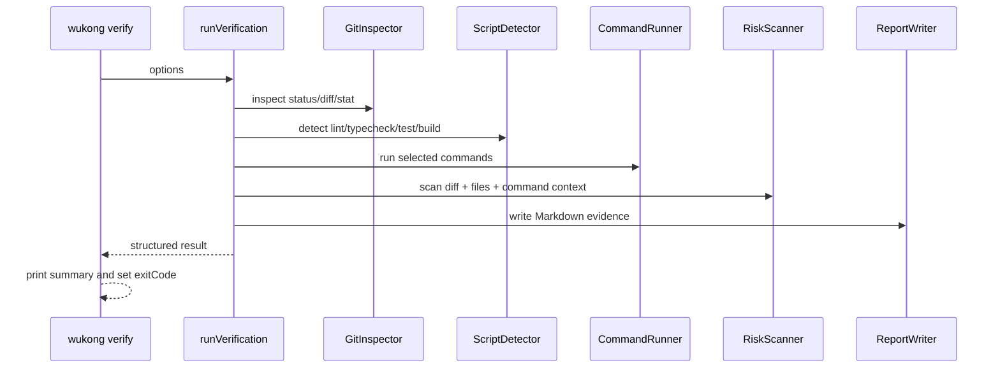
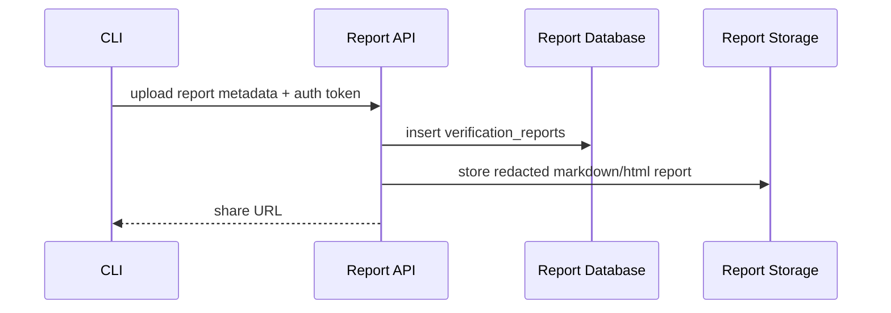

# Wukong 商业化重构技术实现方案

> 版本: v1.1
> 日期: 2026-07-02
> 对应商业方案: `docs/business/COMMERCIAL_REFACTOR_PLAN.md`
> 适用范围: `wukong_cli` 新 Kimi-code base；legacy 代码只作为迁移参考；web/计费不在本轮修改范围内。

---

## 1. 目标与事实基线

### 1.1 技术目标

本方案的目标是把 Wukong 从 "Kimi-code base + 旧版 companion 残留" 重构为 **AI 生成代码的验证与交付证据工具**。

P0 必须交付的真实能力是:

1. `wukong verify`: 本地验证当前代码改动,生成可追溯证据报告。
2. `wukong scan`: 只读风险扫描,不执行项目命令。
3. `wukong guard`: 拦截或确认高风险终端命令。
4. `wukong_verify`: 让外部 AI agent 通过 MCP / tool 方式调用验证。
5. 报告和本地统计为后续云端、团队与商业化能力提供数据基础。

### 1.2 当前事实

当前代码不是从零开始,但也不是商业方案里描述的 "新 base 已经完整实现 verify/guard"。

实际状态如下:

| 模块 | 当前状态 | 处理方式 |
|---|---|---|
| `wukong_cli` | 新 Kimi-code base,已有 CLI/TUI/Server/Agent/MCP/ACP/Provider/Skill 底座 | 作为当前主仓库和运行内核 |
| `wukong_cli_legacy` | 有旧 `verify`、`guard`、`wukong_verify` 实现 | 作为迁移种子,不能作为长期依赖 |

必须修正的口径:

- 商业文档中提到的 `packages/cli/src/commands/verify.ts`、`guard.ts` 是 legacy 路径,不是新 base 路径。
- 新 base 当前 CLI 命令注册点是 `apps/wukong/src/cli/commands.ts`。
- 新 base 当前 CLI 子命令目录是 `apps/wukong/src/cli/sub/`。
- 新 base 当前适合承载共享能力的位置是 `packages/*`,其中 `agent-core` 适合 agent tool,但验证核心建议单独抽包。

---

## 2. 设计原则

### 2.1 核心原则

1. **验证核心独立于 CLI**
   - `verify` 不能只写在 `apps/wukong` 里。
   - CLI、TUI slash command、agent tool、CI 都应复用同一套验证核心。

2. **deterministic verification 与 AI review 分层**
   - `verify` 默认不依赖模型,必须可离线运行。
   - `review --deep` 才调用模型和消耗 credits。

3. **guard 与 scan 共用风险规则**
   - `scan` 发现代码风险。
   - `guard` 拦截命令风险。
   - 两者底层都应复用 `PolicyEngine` / `RiskRule`。

4. **先本地闭环,再外部商业化**
   - P0 先做本地可用。
   - P1 再定义 report metadata、分享链接、quota 接口。
   - P2 再做 team rules、audit log、组织 dashboard。

5. **不复活旧 mcp-server 架构**
   - legacy 的 MCP tool 定义可以迁移。
   - 但新实现应接入新 base 的 `agent-core` / MCP / plugin 架构。

---

## 3. 目标架构



### 3.1 新增包

新增 workspace package:

```text
packages/verification/
  package.json
  tsconfig.json
  src/
    index.ts
    types.ts
    git.ts
    scripts.ts
    runner.ts
    risks.ts
    policy.ts
    report.ts
    verify.ts
    scan.ts
    storage.ts
  test/
    verify.test.ts
    scan.test.ts
    policy.test.ts
    report.test.ts
```

包名建议:

```json
{
  "name": "@wukong/verification",
  "private": true,
  "type": "module"
}
```

先保持 `private: true`,等 API 稳定后再决定是否公开。

### 3.2 CLI 新增文件

```text
apps/wukong/src/cli/sub/verify.ts
apps/wukong/src/cli/sub/scan.ts
apps/wukong/src/cli/sub/guard.ts
apps/wukong/src/cli/sub/review.ts      # P1
apps/wukong/src/cli/sub/ship.ts        # P1
apps/wukong/src/cli/sub/retro.ts       # P1
```

并在 `apps/wukong/src/cli/commands.ts` 注册:

```ts
registerVerifyCommand(program);
registerScanCommand(program);
registerGuardCommand(program);
```

### 3.3 Agent / MCP 工具新增位置

优先接入新 base 工具体系:

```text
packages/agent-core/src/tools/builtin/verification/wukong-verify.ts
packages/agent-core/src/tools/builtin/verification/wukong-verify.md
```

工具名保持:

```text
wukong_verify
```

工具行为:

- 默认使用当前 workspace。
- 可传 `cwd`、`commands`、`includeBuild`、`writeReport`、`reportPath`、`timeoutSeconds`。
- 返回 structured result,不要只返回 Markdown 文本。

---

## 4. P0: `wukong verify`

### 4.1 命令契约

```bash
wukong verify
wukong verify --build
wukong verify --command "pnpm test"
wukong verify --command "pnpm lint" --command "pnpm typecheck"
wukong verify --report ./reports/evidence.md
wukong verify --timeout 180
wukong verify --json
wukong verify --no-report
```

退出码:

| 状态 | 条件 | 退出码 |
|---|---|---|
| passed | 命令全部通过,无 high risk | 0 |
| warning | 命令通过,存在 low/medium risk | 0,除非 `--strict` |
| failed | 任一命令失败,或存在 high risk | 1 |
| invalid | 参数错误、cwd 不存在、报告写入失败 | 2 |

### 4.2 核心类型

```ts
export type VerificationStatus = 'passed' | 'warning' | 'failed';

export interface VerificationOptions {
  cwd?: string;
  commands?: string[];
  includeBuild?: boolean;
  writeReport?: boolean;
  reportPath?: string;
  timeoutMs?: number;
  strict?: boolean;
}

export interface VerificationResult {
  status: VerificationStatus;
  cwd: string;
  generatedAt: string;
  changedFiles: ChangedFile[];
  gitStatus: string;
  diffStat: string;
  selectedCommands: string[];
  commandResults: VerificationCommandResult[];
  risks: VerificationRisk[];
  reportPath?: string;
  report?: string;
}
```

### 4.3 实现流程



### 4.4 命令自动检测

优先级:

1. 用户显式传入 `--command`。
2. `package.json` scripts:
   - `lint`
   - `typecheck`
   - `type-check`
   - `test`
   - `build`,仅 `--build` 时加入
3. 未来扩展:
   - Python: `pytest`, `ruff`, `mypy`
   - Go: `go test ./...`
   - Rust: `cargo test`

P0 只需要稳定支持 Node 项目,其他语言通过显式 `--command` 支持。

### 4.5 风险信号

P0 风险规则:

| 规则 | 严重度 | 检测对象 |
|---|---|---|
| `TODO/FIXME/placeholder/not implemented/coming soon` | high | 新增代码行 |
| `mock/fake/dummy/hardcoded/sample data` | high | 新增代码行 |
| `describe.only/it.only/test.only` | medium | 新增代码行 |
| `describe.skip/it.skip/test.skip` | medium | 新增代码行 |
| `console.log/debug/trace` | medium | 新增代码行 |
| `.env/secret/credential/private-key` 文件变化 | high | changed files |
| 源码变更但无测试变更 | medium | changed files |
| 未发现验证命令 | high | selected commands |
| 非 git repo | medium | workspace |

P1 风险规则:

- 依赖新增和 lockfile diff。
- 删除测试文件。
- 大面积删除。
- 权限敏感文件变化。
- Dockerfile / CI / deploy config 变化。
- secret regex 增强。

---

## 5. P0: `wukong scan`

### 5.1 定位

`scan` 是 `verify` 的只读子集:

- 不运行 `lint/test/build`。
- 不改文件,默认不写报告。
- 适合 pre-commit、CI quick check、AI agent 自查。

### 5.2 命令契约

```bash
wukong scan
wukong scan --diff
wukong scan --secrets
wukong scan --deps
wukong scan --json
wukong scan --report ./reports/risk.md
```

P0 只实现:

- `scan`
- `scan --diff`
- `scan --secrets`
- `scan --json`
- `scan --report`

`--deps` 可以先保留为 planned,不要在 help 中承诺完整 SCA。

### 5.3 复用关系

```text
runVerification()
  -> inspectGit()
  -> detectCommands()
  -> runCommands()
  -> scanRisks()
  -> writeReport()

runScan()
  -> inspectGit()
  -> scanRisks()
  -> optionally writeReport()
```

---

## 6. P0: `wukong guard`

### 6.1 定位

`guard` 是终端命令风险控制层。P0 已实现范围不是完整沙盒或 shell profile 自动注入,而是:

- 本地 guard enable/disable/status/stats。
- 对 `wukong guard -- <command>` 做高风险命令分类。
- 默认阻断高风险命令。
- 用户显式传 `--yes` 时允许执行。
- 记录本地统计。

### 6.2 命令契约

```bash
wukong guard --enable
wukong guard --disable
wukong guard --status
wukong guard --stats
wukong guard -- <command>
```

### 6.3 P0 行为

| 能力 | P0 状态 |
|---|---|
| `guard --status` | 已实现 |
| `guard --stats` | 已实现 |
| `guard --enable` / `--disable` | 已实现,只写本地 config |
| `guard -- <command>` | 已实现,高风险默认阻断 |
| shell profile 自动注入 | P1 |
| agent 祖先进程识别 | P1 |
| sandbox runner | P2 |

### 6.4 后续 shell hook 安装方式

P1 如果要把 guard 自动接到 zsh/bash,不要只写死 `~/.zshrc`。应抽象为:

```ts
interface ShellProfile {
  shell: 'zsh' | 'bash' | 'fish' | 'powershell';
  profilePath: string;
  startMark: string;
  endMark: string;
  renderHook(commands: string[]): string;
}
```

P1 可注入命令:

```bash
alias rm="wukong guard -- rm"
alias git="wukong guard -- git"
alias curl="wukong guard -- curl"
alias wget="wukong guard -- wget"
alias bash="wukong guard -- bash"
alias sh="wukong guard -- sh"
```

这类 alias/hook 只能提供交互式 best-effort 防护,不能作为不可绕过的安全边界。用户仍可通过绝对路径、`command rm`、非交互脚本或其他进程绕过。文档和 CLI 输出必须如实说明这一点。

注意:

- 注入必须幂等。
- disable 必须只删除 Wukong 自己的 block。
- 写入前保留备份,例如 `~/.zshrc.wukong.bak.<timestamp>`。
- `--status` 必须能显示是否已安装、安装在哪个 profile、当前 hook 版本。

### 6.5 风险规则

P0 命令风险:

| 命令 | 条件 | 默认动作 |
|---|---|---|
| `rm` | 包含 `-r` 或 `-f` | block, `--yes` allow |
| `git` | `reset --hard` | block, `--yes` allow |
| `git` | `clean -f`, `clean -df`, `clean -xdf` | block, `--yes` allow |
| `curl/wget` | 上传数据、`-d`、`--data`、`-F`、pipe to shell | block, `--yes` allow |
| `sh/bash/zsh` | 命令包含 `curl` 或 `wget` | block, `--yes` allow |

P1 增强:

- `chmod -R 777`
- `sudo rm`
- `docker system prune`
- `kubectl delete`
- `terraform destroy`
- `DROP TABLE`
- `git push --force`

### 6.6 Agent 触发判断

legacy 用进程祖先链判断 `claude/cursor/copilot/agent/gpt/assistant`。新 base 暂未实现该能力。P1 如果实现,必须明确它是启发式:

```ts
interface AgentDetectionResult {
  triggeredByAgent: boolean;
  ancestors: string[];
  matchedKeyword?: string;
  confidence: 'high' | 'medium' | 'low';
}
```

未来默认策略:

- agent 触发 + high risk: 拦截并确认。
- 人工触发 + high risk: 默认只提醒或按配置确认。
- 用户可配置 `guard.mode = agent-only | always | off`。

### 6.7 本地状态

本地存储:

```text
~/.wukong/guard/config.json
~/.wukong/guard/events.jsonl
~/.wukong/guard/stats.json
```

事件结构:

```ts
interface GuardEvent {
  id: string;
  timestamp: string;
  cwd: string;
  command: string[];
  riskId: string;
  severity: 'high' | 'medium' | 'low';
  action: 'blocked' | 'allowed' | 'confirmed' | 'warned';
  triggeredByAgent: boolean;
  ancestors: string[];
}
```

---

## 7. P0: MCP / Agent Tool `wukong_verify`

### 7.1 目标

让 Claude Code、Cursor、Codex 或其他 agent 在声明完成前调用 Wukong:

```text
wukong_verify({ cwd, includeBuild, timeoutSeconds })
```

### 7.2 工具输入

```ts
const inputSchema = z.object({
  cwd: z.string().optional(),
  commands: z.array(z.string()).optional(),
  includeBuild: z.boolean().optional(),
  writeReport: z.boolean().optional(),
  reportPath: z.string().optional(),
  timeoutSeconds: z.number().positive().optional(),
});
```

### 7.3 工具输出

```ts
interface WukongVerifyToolOutput {
  status: VerificationStatus;
  cwd: string;
  reportPath?: string;
  changedFiles: string[];
  commands: Array<{
    command: string;
    status: 'passed' | 'failed';
    exitCode: number;
    durationMs: number;
  }>;
  risks: VerificationRisk[];
  summary: {
    changedFiles: number;
    commandsRun: number;
    failedCommands: number;
    risksFound: number;
  };
}
```

### 7.4 Agent 行为约束

工具描述中要明确:

- 代码改动后必须调用。
- 不能把文件存在、路由存在当成功能完成。
- 如果 `status = failed`,agent 不能声称任务完成。
- 如果 `status = warning`,agent 必须解释 warning 是否可接受。

---

## 8. P1: `review` / `test` / `ship` / `retro`

这些命令不应在 P0 和 `verify` 抢实现资源。它们应该构建在 `@wukong/verification` 上。

### 8.1 `wukong review`

定位: AI 增强审查。

流程:

1. 先跑 `scan`。
2. 收集 git diff、risk summary、项目元信息。
3. 调用模型生成 review findings。
4. 输出 Markdown review report。
5. `--deep` 消耗 credits。

### 8.2 `wukong test`

定位: `verify --command` 的便利封装。

P1 可实现:

```bash
wukong test
wukong test --watch
wukong test --coverage
```

内部优先选择 package scripts:

- `test`
- `test:unit`
- `test:coverage`
- `test:watch`

### 8.3 `wukong ship`

定位: 发布前 gate。

流程:

1. 检查 git worktree。
2. 跑 `verify --build --strict`。
3. 检查版本、CHANGELOG、未提交文件。
4. 生成 ship report。
5. P1 只做 dry-run,P2 再做 push/PR。

### 8.4 `wukong retro`

定位: 基于 git + verification events 的复盘。

输入:

- git commits
- verification reports
- guard events
- failed command history

输出:

- 本周验证次数
- 失败率
- 常见风险
- 被拦截命令
- 建议改进

---

## 9. 后续云端与商业化接入

本节只定义 `wukong_cli` 需要预留的数据边界。具体 web/API/计费实现不在本轮 `wukong_cli` 修改范围内。

### 9.1 本地数据

P0 本地:

```text
~/.wukong/reports/*.md
~/.wukong/reports/index.json
~/.wukong/guard/events.jsonl
```

P1 之后可以由外部服务接入:



### 9.2 建议外部数据实体

```sql
verification_reports(
  id text primary key,
  user_id text not null,
  org_id text,
  workspace_hash text not null,
  repo_remote_hash text,
  branch text,
  commit_sha text,
  status text not null,
  changed_files_count integer not null,
  commands_run integer not null,
  failed_commands integer not null,
  risks_found integer not null,
  high_risks integer not null,
  report_object_key text,
  created_at text not null
);

guard_events(
  id text primary key,
  user_id text,
  org_id text,
  workspace_hash text,
  command_hash text not null,
  command_preview text not null,
  risk_id text not null,
  severity text not null,
  action text not null,
  triggered_by_agent integer not null,
  created_at text not null
);

team_rules(
  id text primary key,
  org_id text not null,
  rule_type text not null,
  pattern text not null,
  action text not null,
  enabled integer not null,
  created_at text not null,
  updated_at text not null
);
```

### 9.3 配额映射

| Feature | Free | Pro | Team |
|---|---|---|---|
| local verify | unlimited | unlimited | unlimited |
| hosted reports | 3/month | unlimited or high cap | org cap |
| guard intercepts | 3/day | unlimited | policy governed |
| deep review | credits | credits included | pooled credits |
| team rules | no | no | yes |

不要限制本地 `verify` 次数。商业化应限制云端托管、深度模型审查、团队规则和审计能力。`wukong_cli` 侧只需要保证 report metadata、guard event 和 redaction 边界清楚。

---

## 10. 实施里程碑

### Milestone 0: 文档和口径校准

- 新增本技术方案。
- 在商业方案中标注 legacy 资产与新 base 当前状态。
- 修正 README / docs 中对 `verify/guard` 的完成度描述。
- 明确当前发布包名为 `@wukong.today/code`，旧 `@wukong.today/wukong-cli` 不再作为当前文档入口。

验收:

- 文档不再把 legacy 文件当作新 base 文件。
- 安装命令、包名、CLI 名称一致。

### Milestone 1: `@wukong/verification` - 已完成

- 新建 `packages/verification`。
- 从 legacy `Verifier.ts` 迁移核心逻辑。
- 添加 unit tests。
- 支持 `runVerification` 与 `runScan`。

验收:

```bash
pnpm --filter @wukong/verification test
pnpm --filter @wukong/verification typecheck
```

### Milestone 2: CLI `verify` / `scan` - 已完成

- 新增 `apps/wukong/src/cli/sub/verify.ts`。
- 新增 `apps/wukong/src/cli/sub/scan.ts`。
- 注册到 `commands.ts`。
- 添加 CLI tests 或 smoke tests。

验收:

```bash
pnpm -C apps/wukong run dev:cli-only -- verify --no-report
pnpm -C apps/wukong run dev:cli-only -- scan --json
```

### Milestone 3: CLI `guard` - 已完成

- 新增 guard runtime、policy engine。
- 支持 enable/disable/status/stats。
- 写入本地 events/stats。
- 添加安全测试,确认高风险命令默认阻断。

验收:

```bash
pnpm -C apps/wukong run dev:cli-only -- guard --enable
pnpm -C apps/wukong run dev:cli-only -- guard --status
pnpm -C apps/wukong run dev:cli-only -- guard -- rm -rf /tmp/wukong-test
pnpm -C apps/wukong run dev:cli-only -- guard --disable
```

### Milestone 4: `wukong_verify` tool - 已完成

- 在 `agent-core` 新增 builtin verification tool。
- 复用 `@wukong/verification`。
- 返回 structured summary。
- 添加 agent tool 单元测试。

验收:

- 外部 agent 能调用 `wukong_verify`。
- tool 返回 structured result。
- failed 时 agent 能看到失败命令和风险。

### Milestone 4.5: TUI verification slash commands - 已完成

- 新增 `/verify`、`/scan`、`/guard`、`/report`。
- TUI handler 复用 `@wukong/verification`。
- `/report` 读取 workspace 内最新 verification/scan report。
- 添加 TUI handler 单元测试。

验收:

```bash
pnpm --filter @wukong/wukong exec vitest run test/tui/commands/verification.test.ts
```

### Milestone 5: 云端报告与商业化接口

- CLI 登录状态下可选择上传 report metadata。
- CLI 默认不上传源码 diff 或敏感片段。
- 支持外部服务返回 report share link。
- 预留 hosted report quota 和 guard usage quota 字段。

验收:

- 未登录时本地 verify 完整可用。
- 登录上传失败不影响本地报告生成。
- 上传 payload 通过 redaction 测试。

---

## 11. 测试策略

### 11.1 Unit tests

覆盖:

- package manager 检测。
- script 选择。
- diff parser。
- risk scanner。
- report writer。
- policy engine。
- shell hook render/parse/remove。

### 11.2 Fixture tests

建立 fixtures:

```text
packages/verification/test/fixtures/
  clean-node-project/
  failing-test-project/
  placeholder-diff/
  secret-file-change/
  skipped-test-diff/
```

### 11.3 CLI smoke tests

覆盖:

- `wukong verify --json`
- `wukong verify --command`
- `wukong verify --no-report`
- `wukong scan --json`
- `wukong guard --status`

### 11.4 Safety tests

特别测试:

- `guard --disable` 不删除用户原有 shell 配置。
- hook 重复安装不会重复注入。
- wrapper 执行命令时不用 `shell: true`。
- report 不默认上传源码 diff。
- secret-looking diff 不写入云端明文。

---

## 12. 风险与处理

| 风险 | 影响 | 处理 |
|---|---|---|
| 文档先行导致功能被误认为已完成 | 用户安装后发现命令不存在 | Milestone 0 先校准完成度 |
| guard alias 破坏用户 shell | 高 | 幂等 block、备份、status、disable 测试 |
| agent detection 不可靠 | 中 | 明确是 heuristic,支持 `always/agent-only/off` |
| verify 自动检测命令误跑重任务 | 中 | 默认只跑常见短命令,build 需要显式 `--build` |
| report 泄露敏感信息 | 高 | 本地报告默认完整,外部上传默认 metadata + redacted report |
| cloud/sandbox 过早承诺 | 高 | P0 不做完整云终端和隔离沙盒 |
| 包名和安装名不一致 | 高 | 发布前统一 package name、docs、install script |

---

## 13. 推荐优先级

最终推荐执行顺序:

1. `@wukong/verification`
2. `wukong verify`
3. `wukong scan`
4. `wukong guard`
5. `wukong_verify` tool
6. report history / share link
7. `review --deep`
8. team rules / audit log interface
9. sandbox / external cloud execution

只要前五项完成,Wukong 的商业内核就真实成立:
**AI agent 写完代码后,Wukong 提供可复用的验证、风险识别、命令防护和交付证据。**
